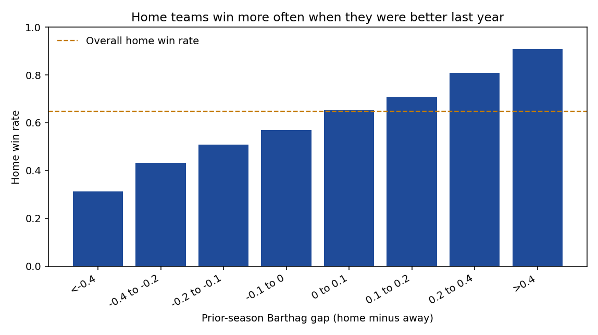
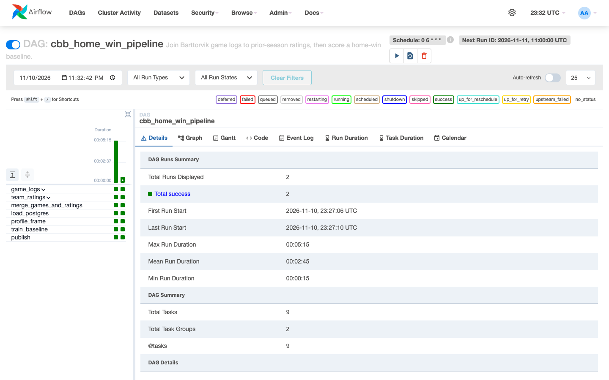
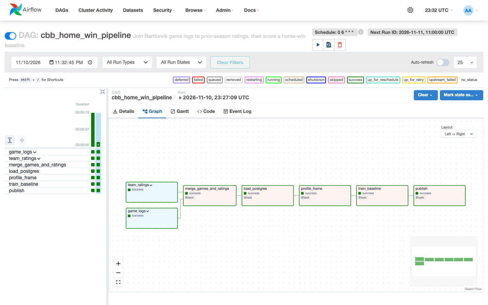
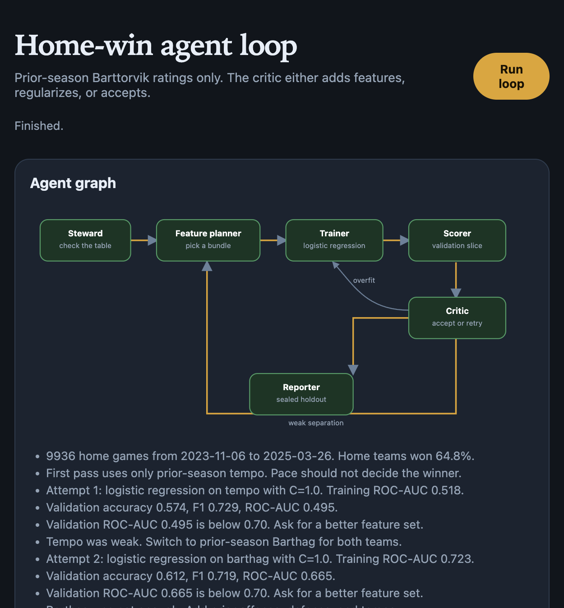
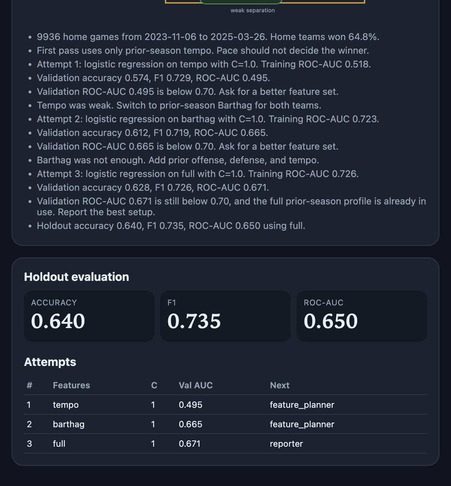

# Week 11: Did the home team win?

Men's college basketball pipeline. Airflow joins two Barttorvik tables and fits one fixed model. A separate agent loop then tries feature sets until the critic stops, and scores the winner once on a holdout.

The shape matches the class demo: parallel checks, a merge, a profile, a baseline, a published table, then a looping agent graph with a sealed holdout. The question, the tables, and the retry rule are different. The class loop researched credit-card fraud and had one revise path. This critic can send a weak model back to the feature planner, or an overfit model straight back to the trainer.

## Question

Did the home team win? Inputs are last season's ratings only. Same-game points and box-score lines are not features.

Home teams won 64.8% of these games, so accuracy is compared with an "always pick home" baseline.

## Data

Both files are public and need no key. Barttorvik rejects a bare script user agent, so the download sends a browser user agent.

- Game logs for the seasons ending 2024 and 2025: `https://barttorvik.com/getgamestats.php?year=YEAR&json=1`
- End-of-season team ratings for 2023 and 2024: `https://barttorvik.com/YEAR_team_results.csv`

Cleaning keeps the home team's row only, so each game appears once. The 2024 games are joined to 2023 ratings, and the 2025 games to 2024 ratings, on Torvik's team name. Games with a team missing from the prior season are dropped.

The published table has 9,936 home games, 362 teams, from 2023-11-06 through 2025-03-26, and no nulls. It is loaded into Postgres as `cbb_home_games` and copied to `data/published/merged_latest.csv`.

## Pipeline

Two downloads start at the same time: the game logs, and the team ratings. Each one is cleaned on its own. Nothing else starts until both are clean.

Then, in order: join the two tables, save the result in Postgres, summarize it, train the simple model, and publish the CSV the agent loop reads.

Airflow runs this every day at 6:00am Eastern. It does not go back and rerun old days. You can also start it immediately with the trigger command below.

The fixed baseline is a logistic regression on prior Barthag for both teams and the gap between them. On the last 15% of games by date (1,491 games):

| | Accuracy | F1 | ROC-AUC |
| --- | --- | --- | --- |
| Always pick home | 0.608 | | |
| Airflow baseline (Barthag) | 0.631 | 0.734 | 0.643 |

The chart is `artifacts/airflow/win_rate_by_barthag_gap.png`. Home win rate rises with last year's Barthag gap.



## Agent loop

Six steps run in order: check the table, pick features, train, score the validation slice, then a critic decides what happens next. If the score is weak, the critic sends the run back to pick a richer feature set. If the training score is much better than the validation score, it sends the run back to train again with stronger regularization. Otherwise it stops and scores the holdout once.

The accept bar is a validation ROC-AUC of 0.70, with at most 4 attempts. The first bundle is tempo on purpose: pace should not pick the winner. A weak score sends the run back to the planner, which adds Barthag, then the full prior-season profile (offense, defense, tempo). If training AUC runs more than 0.08 ahead of validation, the trainer refits with stronger regularization instead of adding features. The holdout is scored once, after the loop, on a refit that may use the training and validation rows.

This run:

| Attempt | Features | Validation ROC-AUC | Critic |
| --- | --- | --- | --- |
| 1 | tempo | 0.495 | weak separation, add Barthag |
| 2 | Barthag | 0.665 | still under 0.70, add the full profile |
| 3 | full profile | 0.671 | no richer prior-season features left |

Holdout for the full profile: accuracy 0.640, F1 0.735, ROC-AUC 0.650. That is a small step past the fixed Barthag baseline (0.643 AUC) and past always picking the home team (0.608 accuracy). Last season's ratings help, and they are not close to a 0.70 AUC. Same-season form is what this model is missing, and it was left out so the label could not leak.

## Run it

Docker Desktop has to be running. From this folder:

```bash
cp .env.example .env
# Set AIRFLOW_UID to the output of: id -u
docker compose up --build -d
```

Airflow: [http://localhost:8088](http://localhost:8088) (`admin` / `admin`).

```bash
docker compose exec airflow-webserver airflow dags unpause cbb_home_win_pipeline
docker compose exec airflow-webserver airflow dags trigger cbb_home_win_pipeline
```

Agent graph: [http://localhost:8000](http://localhost:8000). Press **Run loop** after the DAG has published `data/published/merged_latest.csv`. The same loop from a terminal:

```bash
docker compose run --rm agent python -m agents.run
```

`docker compose down` stops the stack. A dev container is defined in `.devcontainer/devcontainer.json` and uses the `agent` service.

## Screenshots








